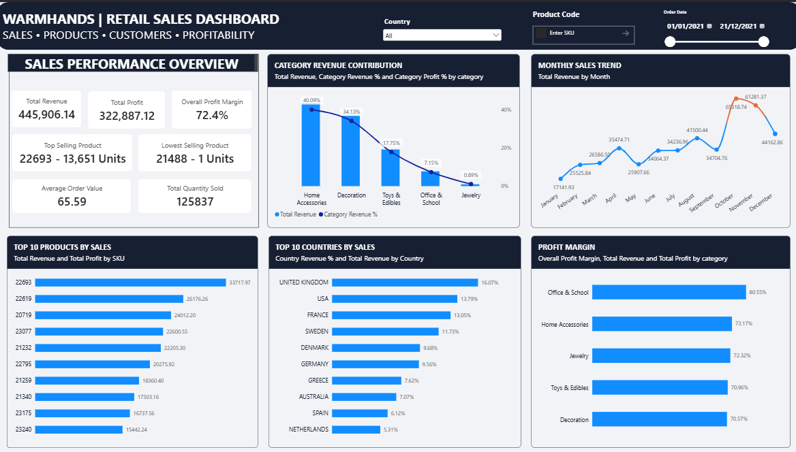

<p align="center">
  
</p>

<h1 align="center">WarmHands – Retail Sales Analysis</h1>

<h3 align="center">Power BI | Excel | Power Query | DAX</h3>

<p align="center">
  An End-to-End Retail Sales Analysis Project
</p>

---

## 📌 Project Overview

An end-to-end retail sales analysis project focused on transforming raw sales data into meaningful business insights through data cleaning, data modeling, DAX calculations, and interactive Power BI visualizations.

The objective is to analyze retail sales performance, evaluate product and category profitability, understand geographic sales distribution, and identify business opportunities.

## 🎯 Business Objectives

- Analyze overall sales and profit performance.
- Identify top-selling and low-performing products.
- Evaluate product and category profitability.
- Analyze sales contribution by country.
- Understand monthly sales trends.
- Provide actionable business recommendations.

## 🗂️ Dataset

**Source File:** `WarmeHands - data.xlsx`

The workbook contains six worksheets:

| Worksheet | Description |
|---|---|
| Orders | Main sales transaction records |
| Stock | Product inventory information |
| Customer | Customer-related information |
| Country | Geographic information |
| Price | Product retail prices |
| Costs | Product cost information |

After data cleaning, the Orders table contained **12,356 records**.

## 🛠️ Tools & Technologies

- Microsoft Excel
- Power Query
- Power BI
- DAX
- Data Cleaning & Transformation
- Data Modeling
- Data Visualization

## 🔄 Project Workflow

### 1. Data Cleaning & Preparation

Used Power Query to:

- Remove duplicate records.
- Handle missing values.
- Change data types.
- Rename columns.
- Handle transformation errors.
- Validate data before merging.

### 2. Data Transformation

Merged the Price table with Orders using the following matching columns:

```text
Orders[SKU] = Price[ID]
```

This added retail price information to the sales transactions.

### 3. Data Modeling

Built a connected Power BI data model using Orders as the central transaction table, supported by Customer, Country, Stock, Price, and Costs tables.

### 4. DAX Measures

Developed DAX measures to analyze:

- Total Revenue
- Total Profit
- Total Quantity Sold
- Average Order Value
- Profit Margin
- Category Revenue Contribution
- Country Revenue Contribution
- Category Profit Contribution
- Top Selling Product
- Lowest Selling Product
- Average Units per Product

## 📊 Dashboard Features

The project includes a single-page interactive Power BI dashboard featuring:

**Key Performance Indicators**
- Total Revenue
- Total Profit
- Average Order Value

**Product Performance**
- Top Selling Product
- Lowest Selling Product
- Top 10 Products by Sales Revenue
- Top 10 Products by Quantity Sold
- Top 10 Products by Profit

**Sales & Geographic Analysis**
- Monthly Sales Trend
- Top 10 Countries by Sales
- Category Revenue Contribution
- Profit Margin by Category

**Interactive Features**
- Date Slicer with Between selection mode.

## 🔍 Key Business Insights

- The Top 10 products generate **48.67% of total revenue**.
- Approximately 26 products generate around 80% of revenue.
- October and November account for **28.39% of annual revenue**.
- Q4 contributes **38.30% of total revenue**.
- The UK, USA, and France together contribute **35.31% of revenue**.
- Home Accessories contributes **40.09% of revenue**.
- Office & School achieves the highest category profit margin at **80.55%**.
- SKU 23077 sold **99.22% of its available stock**.

## 💡 Business Recommendations

- Review pricing and raw material costs for products with below-average margins.
- Prepare inventory ahead of the October and November sales peak.
- Monitor high-demand products to reduce stockout risk.
- Consider targeted marketing campaigns in the UK, USA, and France.
- Review slow-moving products and products with low revenue.

## ⚠️ Scope & Limitations

- Profit deducts raw material costs only; it does not represent net profit.
- The monthly trend covers one year and does not establish multi-year seasonality.
- Findings describe the analyzed data and do not establish causal relationships.

## 👨‍💻 My Role

I completed the project workflow, including:

- Source data review.
- Data cleaning and transformation.
- Data merging and preparation.
- Power BI data modeling.
- DAX measure development.
- Dashboard design.
- Business analysis and recommendations.

## 📚 Skills Demonstrated

`Power BI` `Power Query` `DAX` `Excel` `Data Cleaning` `Data Transformation` `Data Modeling` `Data Visualization` `Business Intelligence` `Retail Sales Analysis`

## 🔗 Portfolio

[View My Data Analytics Portfolio](https://datascienceportfol.io/mmeligy55)

---

<p align="center">
  <strong>Project Type:</strong> Data Analytics Diploma – Training Project
</p>
